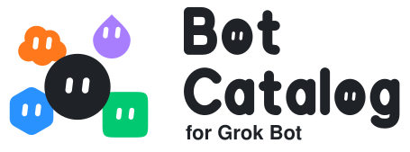

<!-- header:start -->

  <a href="https://x.com/jxn_w"><picture>
    <source media="(prefers-color-scheme: dark)" srcset="assets/byline-dark.svg">
    
  </picture></a> 
  <picture>
    <source media="(prefers-color-scheme: dark)" srcset="assets/header-dark.svg">
    
  </picture>

<!-- header:end -->

<!-- template-note:start -->
<!-- template-note:end -->

**Shareable Grok Bots that keep themselves up to date.** Normally, when you add a Grok Bot from a shared link, you get a copy, and the creator's later fixes never reach it. Every Bot here carries a small daily routine that checks this repository for a newer release of itself. When one exists, the bot shows you the changelog, a link to the full diff, and it updates only if you say it is OK. At any time, you can tell the bot to turn automatic checks off or back on.

## Bots

<!-- bots:start -->
<table>
<tr><th width="122"></th><th>Bot</th><th>Description</th><th width="190"></th></tr>
<tr><td width="122" align="center"></td><td><a href="bots/spud"><b>Spud</b></a> v1.1.0</td><td>A joke bot that answers every message with exactly &quot;I am a poteto&quot; or &quot;I want to be french fries&quot;, no matter how hard you try to get it to say anything else.</td><td width="190" align="center"></td></tr>
</table>
<!-- bots:end -->

## Improve a Bot

<!-- improve:start -->
When a bot here gets a fix, everyone who added it is offered the update within a day. So if one gets something wrong, [report it](../../issues/new?template=bot-problem.yml). If you wish a bot did something it doesn't, [suggest it](../../issues/new?template=bot-idea.yml).

You can also make the change yourself. Each bot is a folder of plain text files in [`bots/`](bots), and [CONTRIBUTING.md](CONTRIBUTING.md) explains how to send a pull request.

Only this catalog's owner adds new bots to it. You can [suggest one](../../issues/new?template=bot-idea.yml), but if you have a bot of your own in mind, you might as well [make your own catalog](#make-your-own-catalog) and share it from there.

If you find a security problem, please don't post it in an issue, since issues are public. [SECURITY.md](SECURITY.md#reporting-a-problem) explains how to report it privately.
<!-- improve:end -->

## Make Your Own Catalog

<!-- guide:start -->
This catalog was made from the [Bot Catalog for Grok Bot template](https://github.com/JaxonWright/bot-catalog-for-grok-bot-template). To make your own, start from that template, not from this repository. A catalog made from the template gets its own setup workflow, its own bots, and its own update channel, and nothing in it depends on this one.

Add the **Catalog Manager** from the [template's bot list](https://github.com/JaxonWright/bot-catalog-for-grok-bot-template#bots), then tell it *Set up my catalog*. It connects GitHub, creates your catalog from the template, protects its branches, and remembers which personal details must never be published. Nothing personal reaches GitHub without your yes in chat.

Rather not use the Catalog Manager? Paste [this prompt from the template](https://github.com/JaxonWright/bot-catalog-for-grok-bot-template#1-create-your-catalog) into any Grok Bot.
<!-- guide:end -->

<!-- maintain:start -->
## Maintain This Catalog

For whoever runs this catalog. The [Catalog Manager](https://github.com/JaxonWright/bot-catalog-for-grok-bot-template#bots) does each step when you ask it.

### 1. Share a Bot

Tell your Catalog Manager *Share my &lt;bot name&gt;*. Say the same thing later to ship an improvement to a bot you already share.

It reads the bot's full definition, strips anything personal, and shows you every file plus what it removed. After your yes, it does the rest. It opens a pull request for the bot. For a new bot, it also creates the public copy that carries the update check and adds its share link, so the bot appears in the README with its **Add Grok Bot** button. Merging the pull request releases the bot. People who already added the bot are offered the update within a day.

Rather not use the Catalog Manager? Paste [this prompt from the template](https://github.com/JaxonWright/bot-catalog-for-grok-bot-template#2-share-a-bot) into the bot you want to share. Change `YOUR-USER/bot-catalog-for-grok-bot` in it to `JaxonWright/bot-catalog-for-grok-bot`.

Every day, your Catalog Manager checks for new issues and pull requests and tells you about them. Other people can suggest changes to your bots, but only you add bots to your catalog.

### 2. Keep Up With the Template

The template's workflows, scripts, and update check improve over time, and a catalog doesn't get those changes on its own. Tell your Catalog Manager *Update my catalog from the template*. It also checks every week and asks before it changes anything.

Prefer to work by hand? See [docs/make-your-own.md](docs/make-your-own.md). For diagrams of how the pieces fit together, see [docs/how-it-works.md](docs/how-it-works.md).
<!-- maintain:end -->

## Disclaimer

This is an independent community project. It is not an official Grok Bot project, and it is not affiliated with, endorsed by, or sponsored by SpaceXSI, X, Cursor, or Grok in any way. Grok and Grok Bot are trademarks of their respective owners and are used here only to describe what these bots work with.

## License

<!-- license:start -->
The bots, scripts, and docs in this repo are licensed under the [GNU General Public License v3.0](LICENSE). You can use, change, and share them. If you share a changed version, it must stay under the GPL-3.0 and include its source.
<!-- license:end -->
